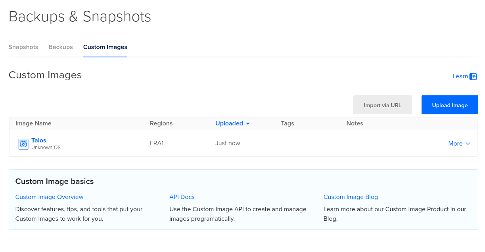

# Talos

- no SSH - everything goes through `talosctl`, see [getting started](https://docs.siderolabs.com/talos/v1.11/getting-started/getting-started)
- a local test cluster:

```fish
talosctl cluster create --workers 3
```

- DigitalOcean imports only the `metal-amd64.qcow2` image from `factory.talos.dev` - `Import via URL`, then nodes from that image


